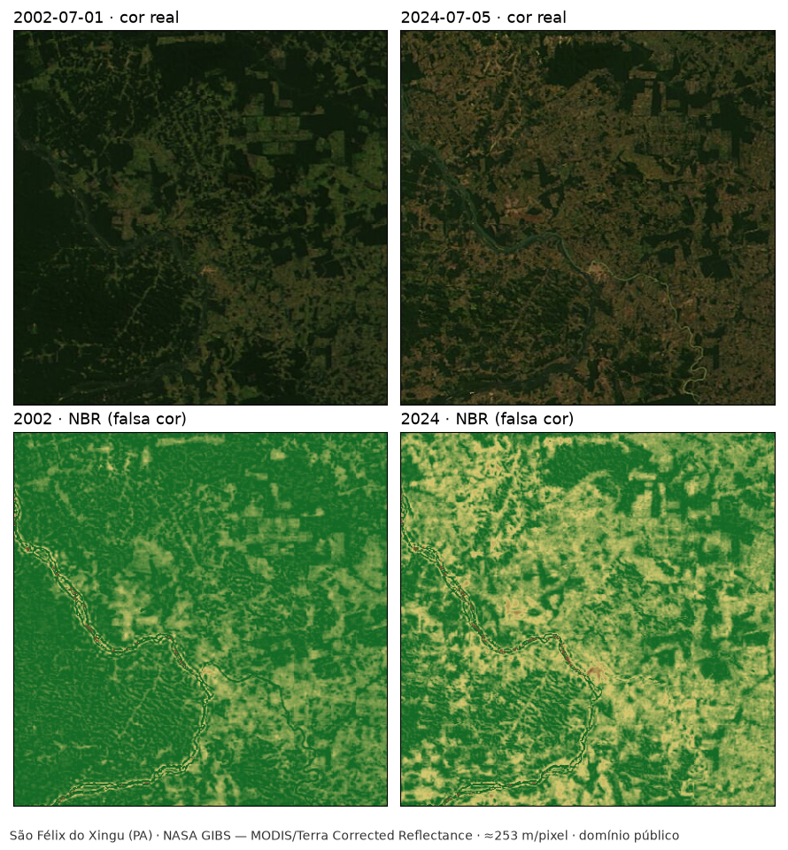

# 1. Introdução

## 1.a. Descrição do Problema

O desmatamento é a remoção da cobertura vegetal nativa de uma área. Detectá-lo e
quantificá-lo em escala regional não é viável por inspeção em campo: as frentes de
supressão ficam em regiões de difícil acesso, avançam continuamente e cobrem áreas
grandes demais para vistoria direta. A observação orbital é o único instrumento que
acompanha esse processo de forma sistemática.

O problema que este trabalho resolve é:

> **Dado um par de imagens de satélite da mesma área geográfica, captadas em datas
> diferentes, identificar automaticamente as regiões que perderam cobertura vegetal entre
> as duas datas e quantificar essa perda em área.**

A formulação é deliberadamente **bi-temporal**. Uma imagem única mostra o que existe, não
o que foi perdido: uma área de pastagem consolidada há trinta anos é indistinguível, numa
única cena, de uma área desmatada no mês passado. A informação de desmatamento está na
**diferença** entre duas datas, não no estado de uma delas.

### Relevância em termos de sustentabilidade ambiental

A supressão de vegetação nativa atua sobre a sustentabilidade por vários caminhos
simultâneos:

- **Emissão de carbono.** A biomassa florestal armazena carbono; sua remoção, em geral
  seguida de queima, transfere esse carbono para a atmosfera.
- **Perda de habitat.** A conversão de floresta em pastagem ou lavoura elimina o habitat
  das espécies que dependem do dossel contínuo, e a fragmentação isola populações
  remanescentes.
- **Ciclo hidrológico.** A floresta participa do transporte de umidade continental pela
  evapotranspiração; a substituição por vegetação rasa altera esse fluxo.
- **Solo.** A exposição direta do solo acelera erosão e perda de fertilidade.

O que torna o problema tratável por computação é que todos esses efeitos decorrem de uma
mudança **opticamente observável**: a assinatura espectral de um dossel florestal é
diferente da de solo exposto ou pastagem, e essa diferença é mensurável a partir do
espaço.

A escala do problema é medida oficialmente. A taxa consolidada de desmatamento da
Amazônia Legal em 2025 — período de 1º de agosto de 2024 a 31 de julho de 2025 — foi de
5.731 km², redução de 12,07% em relação aos 6.518 km² de 2024 (INPE, 2026).

O vínculo com o clima também é quantificado. Em 2024, o setor de mudança de uso da terra,
que abarca sobretudo o desmatamento, respondeu por 42% das emissões brutas de gases de
efeito estufa do Brasil: 906 MtCO₂e (SEEG, 2025).

## 1.b. Contexto

### Por que a resolução do problema importa para a preservação ambiental

Fiscalização ambiental depende de **saber onde olhar**. Um órgão de controle não tem
efetivo para percorrer a totalidade de uma frente de desmatamento; ele precisa de um
sistema que aponte, periodicamente, quais polígonos mudaram desde a última observação.
Detecção automática por imagem de satélite transforma um problema de vigilância
impossível num problema de priorização.

O mesmo vale para a verificação de compromissos: acordos de restauração, embargos,
exigências de rastreabilidade em cadeias produtivas e compromissos de desmatamento zero
só têm efeito se houver como conferir se foram cumpridos. Essa conferência é, na prática,
uma comparação entre duas datas.

### Impacto ecológico

O impacto do desmatamento não é proporcional apenas à área removida, mas também à sua
**geometria**. Um corte de mesma área pode ser mais ou menos danoso conforme a forma:

- Cortes alongados ao longo de estradas — o padrão conhecido como *espinha de peixe*,
  visível nas cenas de Rondônia usadas nos testes deste trabalho — produzem muito mais
  borda por unidade de área do que um corte compacto.
- Borda é onde o microclima muda: a floresta de borda fica mais seca, mais quente e mais
  vulnerável ao fogo do que o interior.
- A fragmentação isola populações de espécies que não atravessam área aberta.

Isso tem uma consequência direta sobre o que o sistema precisa produzir: **não basta um
número de área total**. Um sistema útil precisa entregar as regiões individualmente, com
sua forma e localização, porque a análise ecológica depende disso. É a razão pela qual a
solução deste trabalho rotula componentes conexos e descreve cada região separadamente,
em vez de apenas somar pixels.

### Implicações sociais

- **Territórios tradicionais.** O avanço de frentes de supressão sobre terras indígenas e
  comunidades extrativistas gera conflito fundiário; a detecção remota é frequentemente
  o primeiro registro documental desse avanço.
- **Assimetria de informação.** Sem monitoramento independente, a informação sobre o que
  acontece numa frente de expansão fica restrita a quem está lá. Dado orbital aberto,
  processado por método reproduzível, é um contrapeso a essa assimetria.
- **Custo de erro nas duas direções.** Um falso positivo — acusar desmatamento onde não
  houve — pode gerar sanção indevida sobre um produtor. Um falso negativo deixa passar
  supressão real. Um sistema honesto precisa reconhecer quando **não tem informação
  suficiente** para decidir, em vez de sempre emitir um veredito.

Esse último ponto deixou de ser retórico neste trabalho: o sistema implementado recusa-se
a reportar área quando a cena não sustenta a separação entre as classes, e essa recusa
foi acionada na primeira imagem real processada (Capítulo 4).

A dimensão social aparece nos registros: dos 1.593 conflitos no campo contabilizados
pela Comissão Pastoral da Terra em 2025, 824 ocorreram na Amazônia Legal (CPT, 2026).

## 1.c. Objetivos

### Objetivo geral

Desenvolver uma aplicação em Python que, a partir de um par de imagens reais de satélite
da mesma área em datas distintas, aplique técnicas de processamento digital de imagens
para detectar e quantificar áreas que perderam cobertura vegetal, produzindo dados
preparados para alimentar um modelo de visão computacional.

### Objetivos específicos

1. **Adquirir imagens reais de satélite** de uma frente de desmatamento, de forma
   reproduzível e com procedência registrada — satélite, produto, data, coordenadas,
   licença e URL.
2. **Implementar os filtros de processamento de imagens pelo próprio grupo**, sem recorrer
   a implementações prontas de biblioteca, conforme exige o enunciado.
3. **Realçar a diferença entre vegetação e solo exposto** por meio de índices calculados a
   partir das bandas espectrais.
4. **Segmentar** as áreas de perda de cobertura, separando-as do restante da cena.
5. **Quantificar** a perda em pixels e, havendo resolução espacial conhecida, em hectares,
   descrevendo cada região individualmente.
6. **Preparar recortes rotulados** a partir do resultado da segmentação, no formato que um
   modelo de visão computacional consome.
7. **Treinar e avaliar um classificador** sobre esses recortes, com métrica medida de
   forma a não superestimar o desempenho.
8. **Reconhecer os próprios limites**: quando a imagem disponível não sustenta uma decisão
   confiável, o sistema deve recusar-se a produzir um número, em vez de emitir um
   resultado sem base.

O oitavo objetivo não estava na formulação inicial. Ele foi acrescentado depois que o
critério de confiabilidade, projetado como salvaguarda, foi acionado por uma cena real —
e estava certo ao ser acionado. O relato está no Capítulo 4.

### O que está fora do escopo

Para que os objetivos sejam verificáveis, o que **não** se pretende:

- processar cenas de satélite completas em escala operacional;
- substituir sistemas oficiais de monitoramento;
- classificar o tipo de uso que sucedeu a floresta (pastagem, lavoura, mineração);
- operar em tempo real ou com alerta automático;
- produzir valores de índice espectral comparáveis à literatura científica — o produto de
  imagem utilizado é de visualização, e a discussão dessa limitação está no Capítulo 2.
