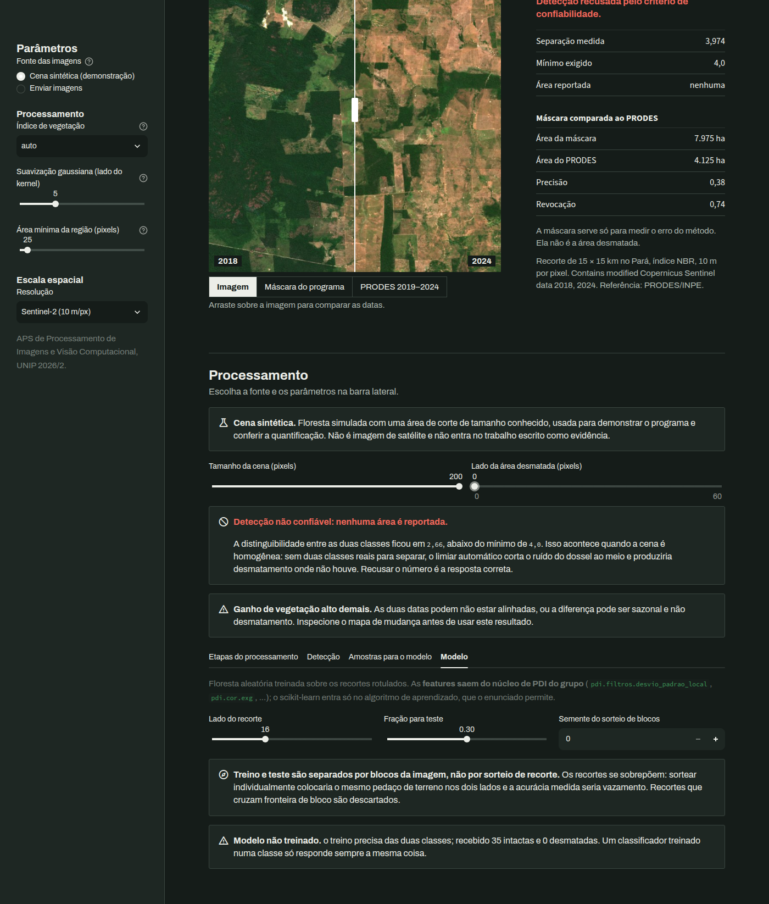
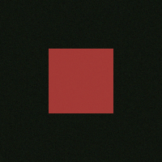
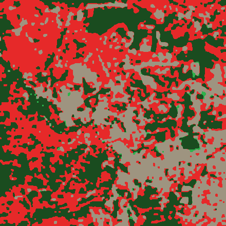
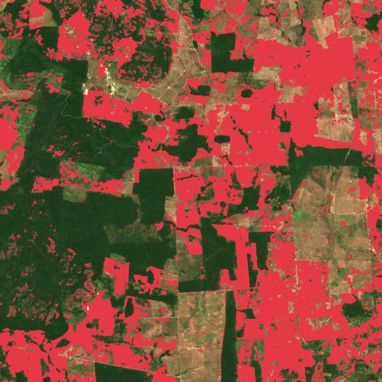
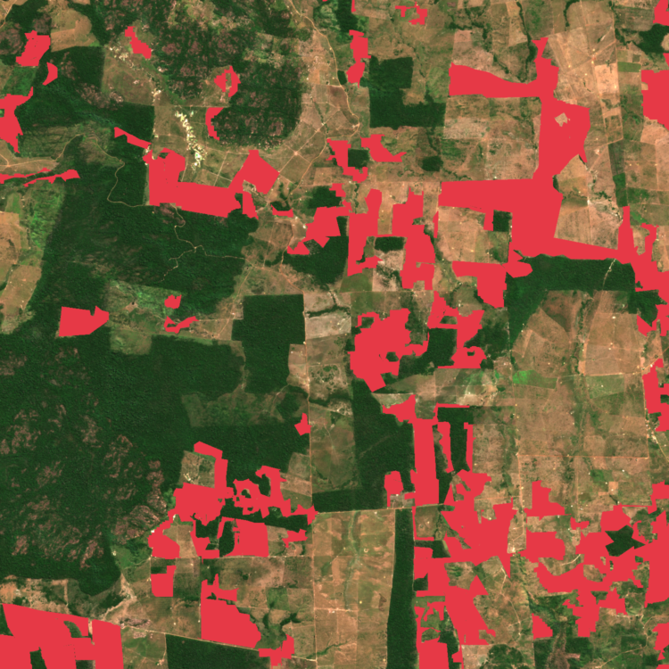

# 4. Desenvolvimento

## 4.a. Como os métodos foram implantados

### Organização do código

O sistema está organizado em camadas, e a ordem das dependências entre elas é uma
restrição de projeto, não uma consequência acidental:

```text
app/ · cli.py          interface e linha de comando
        ↓
pipeline/              orquestra as etapas; não implementa algoritmo
        ↓
dataio/     modelo/    entrada e saída · classificador
        ↓
pdi/                   NÚCLEO — implementado pelo grupo, só NumPy
```

As setas apontam sempre para baixo. O núcleo `pdi/` não importa de nenhuma camada acima
dele: recebe e devolve arrays NumPy puros e não sabe o que é um arquivo, um parâmetro de
interface ou um classificador. É isso que permite testar cada filtro isoladamente contra
um caso analítico, sem montar o sistema inteiro.

A restrição do enunciado foi aplicada de forma verificável: dentro de `src/sentinela/pdi/`
a única dependência externa é `numpy`. O teste `tests/test_restricao_pdi.py` lê a árvore
sintática de cada módulo e falha se houver importação fora de `numpy`, da biblioteca padrão e
do próprio pacote. O código-fonte está no Apêndice.

### Convolução — a operação sobre a qual tudo é construído

A convolução foi implementada varrendo as posições do núcleo e acumulando a imagem
deslocada e ponderada:

```python
for i in range(altura_k):
    for j in range(largura_k):
        peso = kernel[i, j]
        if peso != 0.0:
            saida += peso * estendida[i : i + altura, j : j + largura]
```

São `k²` operações vetorizadas sobre a imagem inteira, em vez de um laço em Python por
pixel. O algoritmo é o mesmo — a diferença é onde o laço acontece. Um laço por pixel numa
imagem de 440 × 440 executaria quase 200 mil iterações interpretadas; este executa 25, com
o trabalho por elemento feito em código compilado.

A correlação cruzada e a convolução foram implementadas **separadamente**, e a segunda é
definida em termos da primeira com o núcleo rotacionado 180°. Não é redundância: a
distinção é conteúdo da disciplina, e manter as duas nomeadas torna possível responder na
arguição qual delas está sendo executada em cada ponto.

### Suavização gaussiana em duas passagens

O filtro gaussiano, que é o do caminho quente, explora a separabilidade do núcleo:
`exp(−(x²+y²)/2σ²) = exp(−x²/2σ²) · exp(−y²/2σ²)`. Em vez de uma convolução por um núcleo
`k × k`, aplica-se uma convolução por um núcleo `1 × k` e outra por um `k × 1`.

O caminho bidimensional continua acessível por um parâmetro, e a equivalência entre os dois
é verificada por teste — inclusive nas bordas e nos quatro modos de tratamento de margem,
que é onde ela poderia falhar. A tabela de tempos está na seção 4.d.

### Rotulagem de componentes conexos

A rotulagem usa varredura em duas passagens com estrutura de união-busca. Na primeira
passagem cada pixel de primeiro plano recebe um rótulo provisório e as equivalências entre
rótulos vizinhos são registradas; na segunda, cada rótulo provisório é substituído pelo
representante da sua classe de equivalência.

A alternativa — busca em profundidade a partir de cada pixel — é mais simples de escrever e
estoura a pilha de recursão em regiões grandes. A união-busca não tem esse problema, e o
caso que a exige apareceu nos testes: uma região em forma de "U" precisa ser reconhecida
como uma só, e ingenuamente ela é rotulada como duas até que a equivalência seja resolvida.

### Morfologia

Erosão e dilatação foram implementadas sobre uma janela deslizante: a erosão é o mínimo
local sob o elemento estruturante, e a dilatação é o máximo. Abertura e fechamento são
composições dessas duas. Definir as quatro a partir de uma única primitiva reduz a
superfície de erro — há um lugar só onde o tratamento de borda precisa estar certo.

### Limiarização e o critério de recusa

O limiar de Otsu foi implementado sobre o histograma, maximizando a variância entre
classes. A implantação tem duas particularidades exigidas pelo problema:

1. **O histograma é conjunto.** O limiar é calculado sobre a soma dos histogramas das duas
   datas, não sobre cada uma separadamente. A justificativa está na seção 3.a.
2. **O resultado é auditado antes de ser usado.** Como o método sempre devolve um valor,
   mesmo sem duas classes a separar, o valor devolvido é submetido a um teste de tamanho de
   efeito. Abaixo do mínimo, o sistema marca a detecção como não confiável e **não reporta
   área**.

A recusa não é um caminho de erro: é um resultado possível do sistema, com representação
própria na estrutura de dados de saída e na interface.

### Preparação de dados para o modelo

A máscara de segmentação fornece o rótulo. A imagem é varrida em janelas, e cada recorte
recebe a classe da região que ele cobre — desde que cubra majoritariamente uma delas.
Recortes que pegam parte de floresta e parte de corte são **descartados**, não arredondados
para a classe majoritária: rotular a borda de um corte ensinaria o classificador a
responder pela vizinhança em vez de pelo conteúdo.

Como a varredura usa passo menor que o lado do recorte, recortes vizinhos compartilham
pixels. Por isso a divisão entre treino e teste é feita **por blocos da imagem**, e só
entram recortes que cabem inteiros num bloco. Como os blocos são disjuntos, nenhum recorte
de treino compartilha pixel com um de teste.

### Aquisição

A aquisição é feita por um script que consulta um serviço público de imagens orbitais e
grava, para cada data, três arquivos: a composição em cor natural para as figuras do
trabalho, a composição de análise com as bandas na ordem que o núcleo espera, e a banda
infravermelha isolada.

Cada cena baixada passa por três medidas de qualidade — ausência de dado, cobertura de
nuvem e bruma — e o script avisa quando alguma delas está fora da faixa aceitável. A
procedência de cada arquivo fica registrada num manifesto: satélite, produto, data,
coordenadas, licença e a URL exata da requisição.

---

## 4.b. Ferramentas utilizadas

| Ferramenta | Versão | Onde | Para quê |
|-----------|--------|------|----------|
| Python | 3.12.3 | todo o projeto | linguagem, conforme sugerido pelo enunciado |
| NumPy | 2.5.3 | `pdi/` e todo o resto | arrays e operações vetorizadas — **única dependência do núcleo** |
| Pillow | 12.3.0 | `dataio/` | abrir e gravar PNG/JPEG — **apenas entrada e saída** |
| scikit-learn | 1.9.1 | `modelo/` | algoritmo de aprendizado (floresta aleatória) |
| Streamlit | 1.63.0 | `app/` | interface de demonstração |
| Matplotlib | 3.11.2 | gráficos | visualizações auxiliares |
| pytest | 9.1.1 | `tests/` | execução da suíte de testes |
| Git | — | repositório | controle de versão |

### Sobre a fronteira de uso de cada biblioteca

A distinção importa porque o enunciado exige que os filtros sejam do grupo:

- **NumPy** fornece a estrutura de array e as operações elementares — soma, produto,
  máximo, ordenação. Não fornece nenhum filtro de imagem. Toda convolução, todo núcleo,
  todo operador morfológico e toda rotulagem deste trabalho estão implementados no
  repositório.
- **Pillow** decodifica e codifica formatos de arquivo. Nenhuma das suas funções de
  processamento é usada; o módulo `PIL.ImageFilter` está explicitamente proibido pelas
  regras do projeto.
- **scikit-learn** fornece o algoritmo de classificação. Os **descritores** que alimentam o
  classificador são calculados pelos filtros do grupo.

### Fonte de dados

| | |
|---|---|
| Serviço | NASA GIBS — acesso público, sem credencial |
| Produto | MODIS/Terra Corrected Reflectance |
| Licença | Domínio público |

| | |
|---|---|
| Serviço | Earth Search e AWS Open Data — acesso público, sem credencial |
| Produto | Sentinel-2 L2A (Contains modified Copernicus Sentinel data 2018, 2024) |

| | |
|---|---|
| Serviço | TerraBrasilis (INPE) — acesso público, sem credencial |
| Produto | PRODES, usado como referência de validação |
| Plataforma | TerraBrasilis (ASSIS et al., 2019) |
| Licença | Creative Commons Atribuição-CompartilhaIgual 4.0, conforme o TerraBrasilis |

---

## 4.c. Como foram feitos os testes

### Princípio: casos analíticos, não comparação com biblioteca

A suíte **não** compara a saída dos filtros com a de OpenCV ou scikit-image. Isso seria
circular em relação ao que o enunciado exige: se o critério de correção fosse "igual ao que
a biblioteca produz", a implementação própria não estaria sendo verificada — estaria sendo
imitada.

Em vez disso, cada filtro é confrontado com uma propriedade matemática cujo resultado é
conhecido de antemão.

| Propriedade verificada | O que ela captura |
|------------------------|-------------------|
| Convolução com núcleo identidade devolve a imagem original | indexação e centro do núcleo |
| Núcleo gaussiano soma 1 | normalização; um erro aqui altera o brilho médio |
| Gaussiano preserva região de intensidade constante | ausência de viés |
| Laplaciano anula rampa linear | segunda derivada de função linear é zero |
| Sobel em rampa devolve gradiente constante | escala e sinal do operador |
| Otsu em histograma bimodal cai entre os dois modos | correção do critério de separação |
| Abertura e fechamento são idempotentes | propriedade algébrica dos operadores morfológicos |
| Região em "U" é rotulada como uma só | resolução de equivalências na união-busca |
| Produto externo dos núcleos 1D reconstrói o núcleo 2D | a separabilidade explorada pelo filtro |

### Teste de cadeia completa contra verdade de terreno

Além dos testes unitários, a cadeia inteira é verificada sobre cenas sintéticas construídas
com área de desmatamento de tamanho **exato e conhecido**. Isso permite medir o erro da
detecção, e não apenas constatar que ela produz alguma saída.

As cenas sintéticas estão identificadas como tais no código e em toda a documentação.
Nenhuma delas aparece como evidência sobre o mundo real.

### Controle negativo

Um sistema de detecção só é confiável se também acertar quando não há nada para detectar.
A suíte inclui o caso de duas datas de floresta intacta, e verifica que o sistema:

1. marca a detecção como não confiável;
2. **não** reporta área;
3. mantém a máscara acessível para inspeção, em vez de escondê-la.

### Teste dos caminhos de erro

Entrada inválida é testada explicitamente: arquivo inexistente, arquivo que não é imagem,
recortes de dimensões diferentes entre as datas, banda infravermelha presente em apenas uma
das datas, imagem em tons de cinza onde se exige RGB, área mínima negativa, resolução
espacial não positiva, treino com uma classe só. Em todos, o critério é a mensagem ser
**explicativa**, não apenas a exceção ser levantada.

### Teste de fumaça da interface



A interface é executada por teste automatizado que verifica que ela não levanta exceção,
que exibe a área correta quando há desmatamento, e que **exibe a recusa** — e não um número
— quando a cena é homogênea.

### Teste da divisão espacial

A propriedade que torna a métrica do modelo honesta — treino e teste não compartilharem
pixel — é verificada por enumeração: os pixels cobertos por cada conjunto são listados e a
interseção é conferida.

### Composição da suíte

| Arquivo | Testes | Cobre |
|---------|-------:|-------|
| `test_segmentacao.py` | 53 | rotulagem, regiões, mudança bi-temporal |
| `test_filtros.py` | 44 | núcleos, suavização, bordas, separabilidade |
| `test_cor.py` | 44 | espaços de cor e índices espectrais |
| `test_pipeline.py` | 38 | orquestração, validação, amostras |
| `test_nucleo.py` | 30 | convolução, bordas, histograma |
| `test_dataio.py` | 29 | entrada e saída, cena sintética, visualização |
| `test_modelo.py` | 26 | descritores, divisão espacial, classificador |
| `test_aquisicao.py` | 12 | qualidade de cena, composição, resolução |
| `test_integracao.py` | 10 | cadeia completa contra verdade de terreno |
| `test_app.py` | 13 | interface, inclusive a recusa sem rótulo para o modelo |
| `test_cli.py` | 9 | linha de comando e apêndice |
| `test_documento.py` | 40 | geração do trabalho escrito e das falas em DOCX |
| `test_restricao_pdi.py` | 15 | importações permitidas no núcleo de PDI |
| **Total** | **363** | |

Reprodução:

```bash
pytest
```

---

## 4.d. Resultados obtidos

### Verificação da cadeia em cena sintética



| Verdade de terreno | Detectado | Erro |
|--------------------|-----------|------|
| 400 px (corte 20×20) | 400 px | 0,0% |
| 6.400 px (corte 80×80) | 6.400 px | 0,0% |

A 10 m/pixel, os 6.400 px equivalem a 64,0 ha. O controle negativo — duas datas de floresta
intacta — é corretamente classificado como não confiável, e nenhuma área é reportada.

**Estes números verificam o encadeamento, não o desempenho no mundo real.** A separação
entre as classes foi construída pelo gerador da cena.

### Desempenho do filtro separável

Medido sobre imagem de 440 × 440 pixels:

| Lado da janela | Núcleo 2D | Dois passes 1D | Ganho |
|----------------|-----------|----------------|-------|
| 3 | 0,9 ms | 0,7 ms | 1,4× |
| 5 | 1,8 ms | 0,8 ms | 2,2× |
| 9 | 5,1 ms | 1,3 ms | 3,9× |
| 15 | 13,5 ms | 2,6 ms | 5,2× |
| 21 | 23,9 ms | 2,5 ms | 9,4× |

Diferença máxima entre os resultados dos dois caminhos: 1,0 × 10⁻⁶ — compatível com o
arredondamento de ponto flutuante de precisão simples.

A cadeia completa de detecção roda em aproximadamente 730 ms sobre uma cena de 440 × 440.

### Resultado do classificador

Sobre a cena sintética, com divisão espacial por blocos e conjunto equilibrado, o
classificador atinge precisão, revocação e F1 iguais a 1,000.

**Este número não valida o modelo**, e o próprio programa emite esse aviso junto da
métrica. Em cena sintética a separação radiométrica entre as classes foi construída; o
resultado demonstra que a cadeia de preparação de dados funciona de ponta a ponta, não que
o classificador funcionaria sobre imagem real.

Os descritores mais influentes na decisão foram a média do canal verde (0,163) e o
percentil 90 do brilho (0,150), seguidos por um empate entre a média do canal azul e a
média do índice de excesso de verde (0,140 cada). A distribuição de importância é bastante
plana — nenhum descritor domina — o que é esperado numa cena em que várias medidas
espectrais separam as classes igualmente bem, por construção.

Uma limitação foi identificada e está declarada: os descritores de **textura não separam as
classes na cena sintética**, porque o gerador aplica o mesmo desvio de ruído às duas. Eles
permanecem no vetor porque devem separar em imagem real — dossel fechado é irregular, solo
exposto é liso — mas isso é hipótese da literatura, ainda não medida. Há teste fixando esse
comportamento, justamente para impedir que sejam apresentados como validados.

### Resultado em imagens reais



| | |
|---|---|
| Área | São Félix do Xingu (PA) |
| Datas | 2002-07-01 e 2024-07-05 |
| Resolução | grade de ≈253 m/pixel; vermelho e NIR nativos em 250 m, SWIR 2 nativo em 500 m |
| Qualidade | 0,0% de nuvem nas duas datas; bruma equiparada |

**O sistema recusou-se a quantificar.**

| Índice | Tamanho de efeito | Veredito |
|--------|-------------------|----------|
| NDVI | 2,994 | recusado |
| NBR (NIR − SWIR 2) | 3,509 | recusado |
| Limiarização da imagem de diferença | 2,788 | recusado |
| *Mínimo exigido* | *4,000* | — |
| *Piso sem duas classes* | *2,650* | — |

A perda de vegetação existe e tem a direção correta. Na escala nativa dos índices,
`[-1, 1]`, a mediana cai de +0,944 para +0,794 no NDVI e de +0,799 para +0,504 no NBR. O
problema é a separação: a 253 m/pixel quase todo pixel da frente de desmatamento contém
floresta, pastagem, regeneração e estrada simultaneamente, o índice de um pixel misto cai
entre as classes puras, e as distribuições das duas datas se sobrepõem fortemente. Há um
vale entre as classes — no NDVI de 2024 aparecem dois montes, perto de 0,72 e de 0,99 — mas
ele é raso demais para que um limiar global atinja o tamanho de efeito exigido.

A análise completa, com as três hipóteses avaliadas, está na seção 3.a.

### Teste a 10 metros e comparação com o PRODES

Para testar o efeito da resolução, a mesma cadeia foi aplicada a um par Sentinel-2 L2A.

| | |
|---|---|
| Cenas | `S2B_T22MCU_20180703T135111_L2A` e `S2A_T22MCU_20240716T135306_L2A` |
| Recorte | 15 × 15 km, 1.500 × 1.500 pixels, na região de São Félix do Xingu e Altamira (PA) |
| Resolução | 10 m/pixel; SWIR 2 nativo em 20 m e reamostrado |
| Qualidade | 0,0% de pixels ruins no recorte, segundo a classificação de cena do produto |
| Referência | PRODES, desmatamento de 2019 a 2024 |

O recorte foi escolhido por um critério fixo, antes de consultar o PRODES, para concentrar
perda de floresta. Por isso ele não representa a região inteira.

Antes de medir esse recorte com NBR, os índices foram comparados nas outras janelas de 15 km do
mesmo tile. Foram excluídas as que cruzam o recorte de teste ou têm 1% ou mais de água, restando
37. As tabelas abaixo usam dois subconjuntos: seis janelas sem desmatamento recente e com menos
de 5% de área antiga registrada, e 22 janelas com pelo menos 3% de desmatamento de 2019 a 2024.

| Índice | Maior valor nas 6 janelas intactas | Menor valor e mediana nas 22 com perda |
|--------|------------------------------------|----------------------------------------|
| NDVI | 3,957 | 2,473 e 3,612 |
| NDMI | 2,547 | 1,991 e 3,647 |
| NBR | 2,504 | 2,396 e 3,711 |

Com esse resultado, o NBR foi fixado para o teste e o critério de 4,0 foi mantido. O NDVI do
recorte já era conhecido nesse momento (3,877). O NBR do recorte deu **3,974, abaixo do mínimo:
o sistema recusou a quantificação**. O limiar conjunto, na escala nativa do NBR, foi +0,387.

Para medir o erro do método, a máscara calculada foi comparada ao PRODES apenas como
diagnóstico. Sua área não é um resultado de desmatamento do recorte.

| Medida | Valor |
|--------|-------|
| Área marcada pela máscara | 7.974,6 ha |
| Área do PRODES no recorte | 4.124,8 ha |
| Precisão contra o PRODES | 0,383 |
| Revocação contra o PRODES | 0,740 |





A máscara encontra boa parte do que o PRODES registra, mas marca quase o dobro da área. Parte
da diferença pode vir de definição: o programa pode reagir a pastagem e regeneração, e o PRODES
considera "a remoção total da vegetação primária" (INPE, [s. d.]). O quanto cada causa pesa não
foi medido.

O resultado tem três limitações principais. Os controles intactos são poucos e vêm de um único
tile. A comparação entre índices usou a máscara simples, sem morfologia nem filtro de área, e
o recorte usou a cadeia completa. E a cena de 2024 é de 16 de julho, enquanto o ano PRODES 2024
pode incluir desmatamento identificado depois dessa data.

Com NBR, um critério perto de 2,8 teria recusado as seis janelas intactas e aceitado 21 das 22
com perda. Isso é uma hipótese, não um novo critério: a amostra é pequena e o valor também
poderia aceitar o par MODIS, que deu 3,509.

Reprodução: `_interno/scripts/baixar_sentinel.py` e `_interno/scripts/validar_prodes.py`.

### Um erro de processo e sua correção

A primeira tentativa de aquisição usou uma data de agosto — auge da estação de queimadas na
região. A cena estava tomada por fumaça, e o controle de qualidade a aprovou com 0% de
nuvem, porque media a cobertura sobre a composição em infravermelho de ondas curtas, e essa
faixa **atravessa a fumaça**.

O efeito foi uma inversão: o índice de vegetação da floresta de 2001 ficou **abaixo** do da
pastagem de 2024. O sistema recusou a detecção e emitiu o aviso de ganho de vegetação
implausível.

A correção foi passar a medir bruma no canal azul da composição visível, onde o
espalhamento atmosférico aparece, pelo percentil 5 — a fumaça levanta o piso da
distribuição porque elimina os pixels escuros da cena. A calibração é reproduzível: 78 na
cena com fumaça contra 6 a 34 nas cenas limpas da mesma área e estação.

O episódio é relatado porque o controle de sanidade funcionou como projetado, e porque a
detecção do erro veio de medição, não de inspeção visual.

### Síntese dos resultados

| O que foi demonstrado | Como |
|-----------------------|------|
| Os filtros são do grupo e estão corretos | 363 testes na suíte, com casos analíticos dos filtros e verificação das importações |
| A cadeia quantifica corretamente | erro de 0,0% contra verdade de terreno construída |
| O sistema reconhece quando não sabe | recusa acionada em cena homogênea e em imagem real |
| A preparação de dados alimenta um modelo | conjunto rotulado, divisão espacial, classificador treinado |
| Os filtros rodam em imagem real de satélite | evidência em `_interno/docs/resultados/imagem-real/` e `_interno/docs/resultados/sentinel-2/` |

| O que **não** foi demonstrado | Por quê |
|-------------------------------|---------|
| Quantificação de área em imagem real | recusa a 253 m e a 10 m; a máscara a 10 m marca quase o dobro da área do PRODES |
| Desempenho do classificador no mundo real | só há medição em cena sintética |
| Utilidade dos descritores de textura | não separáveis na cena sintética |
